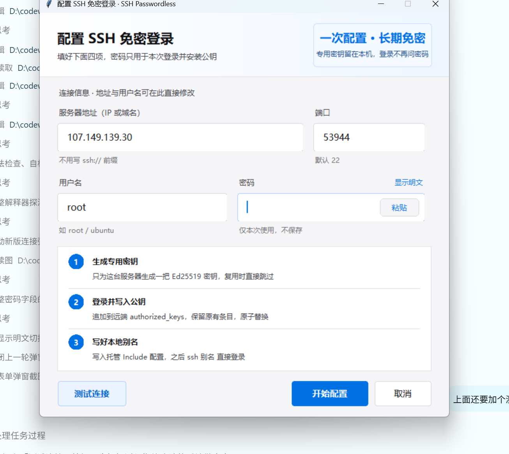

# SSH 免密登录配置（ssh-passwordless）

一次输入密码，之后 `ssh 别名` 直接登录。给 WorkBuddy / Claude Code 这类 AI 助手用的技能包，也是可以直接跑的命令行工具。



## 它做什么

1. 为每台服务器生成**专用** Ed25519 密钥（`~/.ssh/sshpl_<target_id>`），绝不复用 `id_rsa` / `id_ed25519`。
2. 弹出一个窗口，让你填 **地址 / 端口 / 用户名 / 密码**，点「测试连接」先验证通不通。
3. 通了之后用密码登录一次，把公钥**追加**到远端 `~/.ssh/authorized_keys`（加锁 + 临时文件 + 原子替换，保留别人的条目）。
4. 写一份托管配置 `~/.ssh/config.sshpl_<target_id>`，并在 `~/.ssh/config` 里挂一段 `Include`。
5. 用隔离配置做一次**无密码**复核，通过才报告成功。

之后：

```bash
ssh <别名>        # 不再问密码
```

## 安全边界

- 密码**只**从掩码窗口进入内存，不进对话、不进命令行参数、不进环境变量、不落盘；错误信息统一脱敏。
- 主机指纹优先对齐 `known_hosts`；首次连接会显示 `SHA256:` 指纹并要求你明确勾选「已通过可信渠道核对」，随后整个安装过程只接受这一把主机密钥。指纹不一致或 `@revoked` 立即中止。
- 不使用 `StrictHostKeyChecking=no`、`sshpass`、`plink -pw`。
- 远端只追加，不改动 `authorized_keys` 里无关的行；`~/.ssh` 属主与权限（700/600）逐项校验，符号链接一律拒绝。

## 快速开始

```bash
# 1) 体检（缺依赖会提示用国内镜像安装）
python scripts/ssh_passwordless.py doctor

# 2) 缺依赖时自动安装（清华 → 阿里云 → 腾讯云 → 中科大 → 官方）
python scripts/ssh_passwordless.py doctor --install

# 3) 打开连接窗口（地址/端口/用户名/密码都在窗口里填）
python scripts/ssh_passwordless.py setup

# 也可以预填部分信息
python scripts/ssh_passwordless.py setup --host 203.0.113.10 --port 2222 --alias prod-api

# 4) 复核免密（不需要密码）
python scripts/ssh_passwordless.py verify --host 203.0.113.10 --user root --port 2222 --alias prod-api

# 5) 看本机托管了哪些目标
python scripts/ssh_passwordless.py list
```

无图形界面时：`setup --host <host> --user <user> --terminal`（密码用隐藏终端输入，没有测试按钮）。

## 依赖

- Python 3.9+
- `paramiko`、`cryptography`（`doctor --install` 会用国内镜像装）
- OpenSSH 客户端（`ssh`、`ssh-keygen`）
- 弹窗需要带 tcl/tk 的 Python；脚本会自动探测本机可用的解释器，也可以用 `--gui-python` 指定

## 适用于

标准 OpenSSH Linux 服务器：初始允许密码登录、支持 SFTP 的 `posix-rename` 扩展。

**不适用**：跳板机/堡垒机多跳、纯 2FA/MFA、FIPS 受限主机、非标准 `AuthorizedKeysFile`、Windows OpenSSH 服务端。

## 项目结构

```
ssh-passwordless/
├── SKILL.md                     # 技能定义（触发条件 + 执行流程）
├── scripts/
│   ├── ssh_passwordless.py      # 命令行入口：doctor / setup / verify / list / probe / selftest
│   ├── password_dialog.py       # 连接窗口（四个输入框 + 测试连接 + 指纹确认）
│   └── bootstrap_ssh_key.py     # 核心库：密钥、known_hosts、SFTP 原子安装、配置渲染
├── references/
│   ├── how-it-works.md          # 阶段划分、密码生命周期、指纹策略
│   └── troubleshooting.md       # 按阶段排错手册
└── docs/dialog.png
```

## 自检

```bash
python scripts/ssh_passwordless.py selftest
```

31 项契约检查，不联网、不碰真实服务器：参数校验、`authorized_keys` 合并去重、托管 `Include` 幂等、别名冲突、指纹计算、密码通道授权、SFTP 原子安装、路径命名。

## 撤销

删本地 `~/.ssh/sshpl_<target_id>`、`.pub`、`~/.ssh/config.sshpl_<target_id>`，再从远端 `authorized_keys` 删掉注释为 `ssh-passwordless:<target_id>` 的那一行。

## License

MIT
